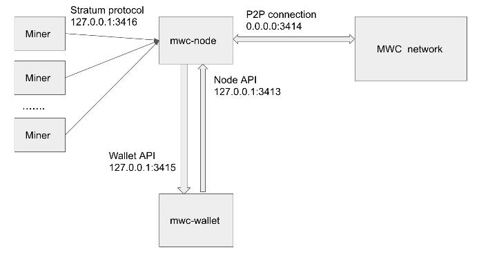
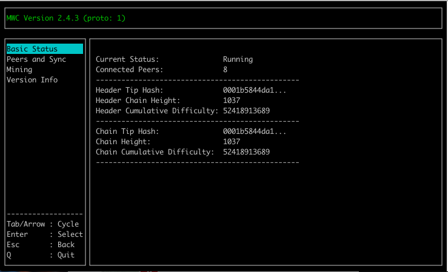
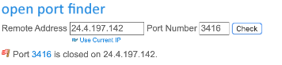
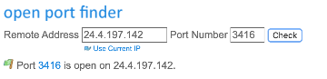

# Mining Setup, macOS

## About

This guide walks through installing and **verifying** a mainnet node, mining
wallet and mining worker. Run the node and wallet on the same host; the worker
can run locally or on another machine. Keep the node and wallet running while
mining.

## Wallet for mining

Use the standalone `mwc-wallet` CLI as the mining wallet. Its foreign API builds
the coinbase output that receives each block reward. Use Slatepack to transfer
mature rewards to your receiving wallet, as shown below.

## Prerequisites

Use Terminal on a supported macOS version. Choose Apple Silicon (`arm64`) or
Intel (`x86_64`) binaries to match your Mac and the release's minimum macOS
version. macOS supplies `curl`, `tar`, `ls`, `tail` and `nc` for the checks below.
Use [Homebrew](https://brew.sh/) for the additional packages described here.

The node's terminal UI uses the macOS curses library. Its standard frameworks,
zlib and iconv are supplied by the OS. Keep any additional libraries distributed
with a release alongside its binaries. A build linked to Homebrew's liblzma
also needs `xz` installed on that host:

```sh
brew install xz
```

For **building from source**, install stable Rust with [rustup](https://rustup.rs)
and the native build tools:

```sh
xcode-select --install
brew install cmake pkg-config xz
```

Use Apple Clang, matching the macOS build pipeline. The compiler, CMake and
pkg-config are build tools; install runtime libraries according to the binary's
dependencies. See [Build and run](../build.md).

## High level Architecture

The node maintains the blockchain and provides work to the mining worker. The
wallet creates the reward output, and the worker submits solutions to the node.



| Connection | Mainnet address in this guide | Purpose |
| --- | --- | --- |
| Wallet → node API | `127.0.0.1:3413` | Refresh wallet state and post transactions |
| Node ↔ network peers | TCP `3414` | Exchange blocks and transactions |
| Node → wallet foreign API | `127.0.0.1:3415` | Build coinbase outputs |
| Mining worker → node Stratum | `127.0.0.1:3416` locally | Receive jobs and submit solutions |

`127.0.0.1` accepts connections from the same host. For a remote worker, bind
Stratum to the node's LAN or VPN address and allow the worker through the
firewall. `0.0.0.0` binds all IPv4 interfaces. Keep the wallet and node API
listeners on loopback for this setup. Outbound peer connections allow the node
to synchronize; an inbound TCP `3414` rule also lets other nodes connect to it.

Stratum uses plain TCP. Use a VPN or an SSH tunnel to protect mining traffic
over an untrusted network.

## Data Location, data clean up

The default mainnet data directory is `~/.mwc/main`:

| Path under that directory | Contents |
| --- | --- |
| `mwc-server.toml` | Node configuration |
| `mwc-server.log` | Node log |
| `chain_data/` | Blockchain and peer databases |
| `.api_secret`, `.foreign_api_secret` | Node API credentials |
| `mwc-wallet.toml` | Wallet configuration |
| `mwc-wallet.log` | Wallet log |
| `wallet_data/wallet.seed` | Encrypted wallet seed |
| `wallet_data/db/`, `wallet_data/saved_txs/` | Wallet records and saved transactions |

Floonet uses `~/.mwc/floo`. A configuration in the working directory, or an
explicitly selected configuration/data directory, changes these locations.
Check the configured paths when using an existing installation.

Before cleaning up, stop the affected processes and back up the wallet data,
configuration and recovery phrase. Keep the recovery phrase securely offline.
For a deliberate blockchain rebuild, move only `chain_data` to a backup location
and restart the node to synchronize again. Preserve `wallet_data` and the API
credentials so the wallet and its pending transaction records remain available.

## Install of MWC node and mwc-wallet

Download matching releases for your operating system and CPU architecture from
[mwc-node releases](https://github.com/mwcproject/mwc-node/releases) and
[mwc-wallet releases](https://github.com/mwcproject/mwc-wallet/releases).
Read their release notes for network upgrade requirements. Download the matching
SHA-256 checksum files alongside the archives; the release scripts name these
`*-sha256sum.txt`.

Replace `NODE_ARCHIVE.tar.gz` and `WALLET_ARCHIVE.tar.gz` below with the
downloaded filenames. Calculate their hashes and compare the hexadecimal values
with the matching checksum files:

```sh
shasum -a 256 ~/Downloads/NODE_ARCHIVE.tar.gz
shasum -a 256 ~/Downloads/WALLET_ARCHIVE.tar.gz
```

Each command prints a 64-character hexadecimal hash followed by the filename.
Compare that hash with the SHA-256 value in the matching checksum file. Proceed
when both archive hashes match. If a value differs, download the archive and
its matching checksum file again and repeat the check.

Extract into `~/my_mwc_install`:

```sh
mkdir -p ~/my_mwc_install
cd ~/my_mwc_install
tar -xzf ~/Downloads/NODE_ARCHIVE.tar.gz
tar -xzf ~/Downloads/WALLET_ARCHIVE.tar.gz
```

The release archives place the executables in `mwc/mwc` and
`mwc-wallet/mwc-wallet`. Confirm both start:

```sh
./mwc/mwc --version
./mwc-wallet/mwc-wallet --version
```

Each command should print the program's version and return to the prompt.
Check that the versions match the releases you downloaded. If either command
reports an unsupported executable or a missing library, resolve the architecture
or runtime dependency using the prerequisites above before starting the node.

If macOS reports a missing dynamic library, inspect the executable with `otool`
from the Xcode command-line tools:

```sh
otool -L ./mwc/mwc
otool -L ./mwc-wallet/mwc-wallet
```

The output lists the library paths linked into each executable. Locate the
library named in the startup error and install its runtime package; for example,
Homebrew `xz` supplies its `liblzma` library. Repeat `--version` to confirm that
the executable now starts.

To transfer mature mined coins, create an encrypted Slatepack. Replace the
recipient address and amount with your receiving wallet's address and the
amount to transfer:

```sh
~/my_mwc_install/mwc-wallet/mwc-wallet send --method slatepack --slatepack_recipient 'RECIPIENT_ADDRESS' --dest mined.slatepack 10
```

Receive `mined.slatepack` in the destination wallet and save its response as
`mined.response.slatepack`. Finalize and broadcast it from the mining wallet:

```sh
~/my_mwc_install/mwc-wallet/mwc-wallet finalize --file mined.response.slatepack
```

## Start the node

Open a terminal and start the node:

```sh
~/my_mwc_install/mwc/mwc server run
```



Use the terminal interface to watch synchronization. Explore available commands
in another terminal with `~/my_mwc_install/mwc/mwc --help` and `~/my_mwc_install/mwc/mwc server --help`.

#### Validate the node install

Check that the first run created the node's configuration and data directory:

```sh
ls -la ~/.mwc/main
```

The listing should include these entries:

- `mwc-server.toml` — node configuration.
- `mwc-server.log` — node log.
- `.api_secret` and `.foreign_api_secret` — API credential files.
- `chain_data` — blockchain data directory.

If an entry is missing, check whether the node uses a configuration in another
working directory or has reported a startup error.

If startup fails or synchronization stops progressing, read the latest log
entries:

```sh
tail -n 50 ~/.mwc/main/mwc-server.log
```

This prints the last 50 lines. Look for `ERROR` entries describing the failure,
such as a port already in use or an inaccessible data directory. Correct the
reported cause and restart the node if it exited. For synchronization problems,
use the diagnostic guidance linked below.

Before mining, wait for `Current Status: Running` and check that the validated
chain height has caught up with the header chain and connected peers. See
[Chain synchronization](../chain/chain_sync.md) for the stages and diagnostics.
Use a separate data directory and distinct listener ports for each additional
instance on the same machine.

## Init wallet

Explore the commands and initialization options:

```sh
~/my_mwc_install/mwc-wallet/mwc-wallet --help
~/my_mwc_install/mwc-wallet/mwc-wallet init --help
```

For a new mining wallet, run:

```sh
~/my_mwc_install/mwc-wallet/mwc-wallet init
```

Enter a strong password when prompted. Write down the generated recovery phrase
and store it securely offline. The phrase lets you recover your funds if the
wallet files are lost; a full wallet backup also preserves transaction records.

To recover an existing wallet into a fresh wallet directory, enter its recovery
phrase at the prompt and choose a new password:

```sh
~/my_mwc_install/mwc-wallet/mwc-wallet init --recover
~/my_mwc_install/mwc-wallet/mwc-wallet info
```

Run `info` after the node is synchronized and the wallet's node address and
credentials match the settings described below. It automatically synchronizes
the recovered wallet with the node and displays the balance. For recovery from
a backed-up `wallet.seed`, restore that file into the configured wallet data
directory while the wallet is stopped, retain its original password, and then
run `info`.

#### Validation

Check that initialization created the wallet configuration and encrypted seed:

```sh
ls -la ~/.mwc/main
ls -la ~/.mwc/main/wallet_data
```

The first listing should include `mwc-wallet.toml`, `mwc-wallet.log` and
`wallet_data`. The second should include `wallet.seed`, `db`, `saved_txs` and
`archived_txs`. The transaction directories can be empty for a new wallet.

If initialization reported an error or the seed is missing, check the configured
data directory and inspect the last 50 wallet log lines:

```sh
tail -n 50 ~/.mwc/main/mwc-wallet.log
```

Look for the error describing why initialization failed, such as a directory
access problem. Resolve that cause before starting the listener. For an
existing wallet, preserve its seed and use its original password.

## Start Listener for the Wallet

Edit the existing `[wallet]` section in `~/.mwc/main/mwc-wallet.toml` to enable
the local foreign API socket:

```toml
[wallet]
api_listen_interface = "127.0.0.1"
api_listen_port = 3415
check_node_api_http_addr = "http://127.0.0.1:3413"
```

Update these keys within the generated section and retain its other settings.
Confirm that `node_api_secret_path` points to the node's `.foreign_api_secret`
file. The default node and wallet paths share `~/.mwc/main/.foreign_api_secret`;
for a custom layout, use the absolute path to the node's file.

Start the wallet's socket listener in a separate terminal:

```sh
~/my_mwc_install/mwc-wallet/mwc-wallet listen --no_tor
```

Enter the wallet password and leave the listener running. The node calls this
local listener to create coinbase outputs while mining.

#### Validate

Check `~/.mwc/main/mwc-wallet.log` for listener startup or binding errors. Query
the foreign API from the same host:

```sh
curl -H 'Content-Type: application/json' --data '{"jsonrpc":"2.0","method":"check_version","id":1,"params":[]}' http://127.0.0.1:3415/v2/foreign
```

Expect `result.Ok` containing `foreign_api_version` and
`supported_slate_versions`. A connection failure means the socket could not be
reached; check that the listener is running at the configured interface and
port. If the response contains `error` or `result.Err`, use its message and the
wallet log to resolve the failure before continuing.

For a one-time check that the wallet can build a coinbase, send this request:

```sh
curl -H 'Content-Type: application/json' --data '{"jsonrpc":"2.0","method":"build_coinbase","id":1,"params":{"block_fees":{"fees":0,"height":5,"key_id":null,"binding_digest":"0101010101010101010101010101010101010101010101010101010101010101"}}}' http://127.0.0.1:3415/v2/foreign
```

Expect `result.Ok` with `output`, `kernel`, `key_id` and `coinbase_opening`
(66 hexadecimal characters). This check creates an unconfirmed candidate output
in the wallet. The sample height and `binding_digest` belong to this check;
during mining, the node supplies the actual height and digest for each template.
Loopback requests are permitted by the wallet's mining API access policy.
If this request returns `error` or `result.Err`, inspect its message and the
wallet log. Continue after the wallet successfully returns the coinbase fields.

## Setup mwc-node to run miner locally

Keep the wallet listener running. Stop the node, then update the existing
`[server.stratum_mining_config]` section in `~/.mwc/main/mwc-server.toml`:

```toml
[server.stratum_mining_config]
enable_stratum_server = true
stratum_server_addr = "127.0.0.1:3416"
wallet_listener_url = "http://127.0.0.1:3415"
burn_reward = false
```

`wallet_listener_url` is the base URL of the mining wallet. With
`burn_reward = false`, the node obtains reward outputs from that wallet.
Restart the node:

```sh
~/my_mwc_install/mwc/mwc server run
```

#### Validate

Check the Stratum startup message and the listening socket:

```sh
grep 'Stratum server started' ~/.mwc/main/mwc-server.log
nc -vz 127.0.0.1 3416
```

The first command should find `Stratum server started on 127.0.0.1:3416`
from the current node run. The second command should report that the connection to port `3416` succeeded.
If the startup message is missing or the connection fails, check that the
running node loaded the edited configuration and review its startup log.
Check the wallet log if the node reports a failure obtaining a reward output.

To check the protocol, open a connection:

```sh
nc 127.0.0.1 3416
```

A successful connection stays open, ready for input. Paste these JSON requests
into it one at a time, pressing Enter after each line. Log in before requesting
work:

```json
{"id":"1","jsonrpc":"2.0","method":"login","params":{"login":"setup-check","pass":"x","agent":"setup-check"}}
{"id":"2","jsonrpc":"2.0","method":"getjobtemplate","params":null}
```

The login response has `"id":"1"` and `"result":"ok"`. The job response has
`"id":"2"` and a `result` containing `height`, `job_id`, `difficulty` and
`pre_pow`. The server can also send asynchronous `job` notifications.
If the node reports that it is syncing, wait for synchronization to complete
and repeat the check. For another RPC error, inspect the node and wallet logs.
Press Ctrl+C to close the test connection. See [Stratum protocol](../stratum.md)
for request and response details.

## Setup mwc-node to run a miner on a different host

Keep the wallet listener on the node host. Stop the node and change the Stratum
binding in `~/.mwc/main/mwc-server.toml` to its LAN or VPN address. Replace the
example `192.168.1.10` with an address assigned to the node host:

```toml
[server.stratum_mining_config]
enable_stratum_server = true
stratum_server_addr = "192.168.1.10:3416"
wallet_listener_url = "http://127.0.0.1:3415"
burn_reward = false
```

Use `0.0.0.0:3416` when listening on all IPv4 interfaces is appropriate for your
firewall rules. Restart the node with `~/my_mwc_install/mwc/mwc server run`.

#### Validate node from local host

Look for `Stratum server started on 192.168.1.10:3416` in
`~/.mwc/main/mwc-server.log`. Test the address configured above:

```sh
nc -vz 192.168.1.10 3416
```

Expect a message that the connection to `192.168.1.10` port `3416` succeeded.
If it fails, confirm that this address belongs to the node host, the node was
restarted with that binding, and the host firewall permits the connection.

#### Obtain my public IP

For a worker on the same LAN or VPN, use the node's LAN or VPN address.
For an internet connection through port forwarding, obtain the public WAN
address from the router's status page. Record that address for the worker's
configuration. If your ISP uses carrier-grade NAT, arrange a reachable public
address or use a VPN that connects the two hosts.

#### Open port at macOS

In **System Settings → Network → Firewall → Options**, add the installed
`mwc` executable and allow incoming connections. Keep the firewall enabled and
restrict access to the worker through your router or VPN rules. See
[Apple's firewall instructions](https://support.apple.com/guide/mac-help/mh34041/mac).

#### Do you have a router? Map 3416 port for incoming connections

For an internet connection through a NAT router, forward TCP port `3416` to
port `3416` at the node's LAN address. Reserve that LAN address in the router's
DHCP settings so the forwarding rule remains valid. Use your router vendor's
port-forwarding instructions and restrict the permitted source to the worker
where supported. LAN and VPN workers connect directly to the corresponding
node address.

Find the node's LAN address in **System Settings → Network → your active
connection → Details → TCP/IP**.

#### Validate if your port is open for INCOMING connections

Test access from the worker's network. An external
[port checker](https://www.yougetsignal.com/tools/open-ports/) can also test a
public forwarding rule. These screenshots illustrate a closed and an open port:





A firewall restricted to the worker's source address can reject a public port
checker's probe. Use the worker-host connection test below to verify the intended
route. If it fails, check the listener address, firewall rule, forwarding rule
and public address in that order.

#### Validate stratum connection from your miner's host

On a macOS or Linux worker, replace `NODE_IP` with the node's reachable address:

```sh
nc -vz NODE_IP 3416
```

Expect a message that the connection to the node on port `3416` succeeded.
If it reports refusal or a timeout, check the listener, firewall and forwarding
rules before starting the worker.

For the protocol check, use `nc NODE_IP 3416` and the `login` and
`getjobtemplate` requests from the local validation step.

On a Windows worker, run this in PowerShell and check for
`TcpTestSucceeded: True`:

```powershell
Test-NetConnection -ComputerName NODE_IP -Port 3416
```

If `TcpTestSucceeded` is false, check the same listener and network rules.

Then start the worker and confirm successful login and incoming mining jobs.
The node's Mining screen shows the worker and its accepted/rejected shares.

#### Node setup is done for remote access

With the connection checks passing, keep the node and wallet listener running
and configure the worker for the reachable Stratum address.

## MINER

Choose a worker supporting **MWC Cuckatoo31 (C31)** and the MWC Stratum protocol.
Install the GPU driver and runtime required by that worker on the mining host.
Choose hardware with enough memory for its C31 solver. Use `127.0.0.1:3416` for
a local worker, or the node's reachable LAN, VPN or public address for a remote
worker. The worker name labels its connection in the node's Mining screen;
the configured wallet listener determines where rewards are received.

#### Mwc miner

The [mwc-miner project](https://github.com/mwcproject/mwc-miner) provides mining
plugins. Its current Cargo target is `grin-miner`, and its configuration file is
`grin-miner.toml`. In the existing `[mining]` section, set:

```toml
[mining]
stratum_server_addr = "127.0.0.1:3416"
stratum_server_login = "worker-1"
stratum_server_password = "x"
stratum_server_tls_enabled = false
```

Select a C31 plugin compatible with the mining host, such as
`cuckatoo_mean_cpu_compat_31` for x86_64 CPU testing, or a C31 CUDA/OpenCL plugin
for supported hardware. Enable the selected plugin's configuration block and
keep its dependencies installed on the worker. Run the miner from the directory
containing `grin-miner.toml`; its configured log path defaults to `grin-miner.log`.

The CPU plugins use x86_64 instructions. For an Apple Silicon node host, use
a worker with a supported solver on another machine and connect it through
the remote-worker setup above.

For source builds with CMake 4, set `CMAKE_POLICY_VERSION_MINIMUM=3.5` before
running `cargo build --release` to configure the reference miner's plugins.

#### GMiner

Use a [GMiner release](https://github.com/develsoftware/GMinerRelease/releases)
that includes an MWC C31 solver for your GPU. Check that release's `--help` for
supported algorithms and its required GPU driver. For a release listing
`mwc31`, run:

On the Linux mining host:

```sh
./miner --algo mwc31 --server NODE_IP --port 3416 --user worker-1
```

On a Windows mining host, use `./miner.exe` in PowerShell with the same options.

Replace `NODE_IP` with the address verified above. Check successful login,
incoming jobs and accepted shares in both the worker and node. Keep the worker's
connection mode set to plain Stratum TCP for the listener configured here.

## Checking your coins

In another terminal, refresh the wallet balance and list its outputs:

```sh
~/my_mwc_install/mwc-wallet/mwc-wallet info
~/my_mwc_install/mwc-wallet/mwc-wallet outputs
```

`info` displays the wallet balance, including `Currently Spendable` and, when
applicable, `Immature Coinbase`. `outputs` lists individual outputs with their
`Block Height`, `Status` and `Coinbase?` fields. Use these to identify the rewards
from accepted blocks and check their maturity. If the wallet reports a failed
node refresh, check the node connection and API credentials before relying on
the displayed balance.

An accepted **block** earns the coinbase reward; accepted shares show worker
progress toward finding a block. Newly mined rewards appear as immature outputs
and become spendable after the consensus maturity period of 1,440 blocks.
Keep the node synchronized and use the wallet's spendable balance when preparing
a transfer.
